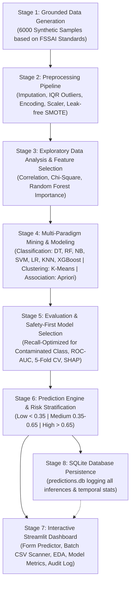

# Food Adulteration Risk Prediction Using Data Mining Techniques

[](https://share.streamlit.io/)
[](https://www.python.org/downloads/)
[](https://opensource.org/licenses/MIT)
[]()

> **CRITICAL DISCLAIMER: SYNTHETIC DATA — GENERATED FOR ACADEMIC DEMONSTRATION**  
> *This system is developed strictly for academic evaluation in the Data Mining Techniques course. The underlying dataset consists of 6,000 synthetically generated samples grounded in published FSSAI food safety regulations and surveillance parameters. It is **NOT** a substitute for certified laboratory chemical/biological testing, and must not be used for real-world regulatory enforcement or clinical dietary safety decisions.*

---

## 📌 Project Overview

Food adulteration poses severe public health hazards, economic fraud, and regulatory challenges across domestic and commercial supply chains. While the Food Safety and Standards Authority of India (FSSAI) publishes national aggregate surveillance reports, sample-level laboratory assay records are generally proprietary or confidential.

This project delivers an end-to-end, reproducible Data Mining and Machine Learning framework that predicts food adulteration risk from measurable physical, chemical, logistical, and sensory quality indicators. 

### Key Capabilities
- **Multi-Class Food Matrix:** Analyzes 7 critical food categories (*Milk, Edible Oil, Spices, Grains, Honey, Beverages, and Processed Foods*).
- **Tri-Level Risk Stratification:** Converts probabilistic outputs into actionable risk bands:
  - **LOW RISK ($p < 0.35$):** Conforms to safety norms (*Safe*).
  - **MEDIUM RISK ($0.35 \le p \le 0.65$):** Borderline anomalies detected (*Retest Advised*).
  - **HIGH RISK ($p > 0.65$):** Severe contamination indicators (*Adulterated — Immediate Lab Confirmatory Testing Required*).
- **Explainable AI (XAI):** Integrated SHAP (SHapley Additive exPlanations) and tree-based feature attribution to provide inspectable rationale for every prediction.
- **Audit Provenance:** SQLite database logging for continuous inspection tracking and historical analytics.

---

## 👥 Academic & Team Details

- **Course:** Data Mining Techniques (DMT)
- **Degree:** Bachelor of Technology (B.Tech) in Information Technology
- **Institution:** K. Ramakrishnan College of Technology (Autonomous), Trichy, Tamil Nadu, India
- **Project Team:**
  - **Jayanth S** (Reg No: `2403811720521023`)
  - **Jithin AK** (Reg No: `2403811720521025`)
  - **Keerthivasan RP** (Reg No: `2403811720521026`)

---

## 🏛️ System Architecture

The pipeline strictly adheres to an 8-stage data mining lifecycle:



1. **Stage 1 — Data Generation:** Mathematical synthesis of 6,000 samples with realistic adulterant physics (e.g., starch in milk, argemone oil substitution, synthetic dyes in spices).
2. **Stage 2 — Data Preprocessing:** Missing value handling, outlier clipping via Interquartile Range (IQR), Ordinal/One-Hot encoding, and SMOTE applied exclusively to the training split to avoid data leakage.
3. **Stage 3 — Feature Selection & EDA:** Correlation filtering, Chi-Square test of independence, and Gini importance ranking to isolate top predictive drivers.
4. **Stage 4 — Model Building:** Comprehensive benchmarking spanning decision trees, ensembles, probabilistic classifiers, kernel SVMs, K-Means clustering, and Apriori association mining.
5. **Stage 5 — Evaluation & Model Selection:** Rigorous selection prioritizing **Recall (Sensitivity)** on the adulterated class to eliminate dangerous false negatives.
6. **Stage 6 — Prediction Engine:** Standardized inference pipeline outputting binary labels, class confidence, and calibrated risk tiers.
7. **Stage 7 — Streamlit Cloud Dashboard:** Multi-page interactive application for field inspectors.
8. **Stage 8 — SQLite Audit Layer:** Real-time persistence of all inspection inputs, probabilities, and diagnostic outputs.

---

## 📁 Repository Directory Structure

```text
food-adulteration-risk/
├── app/
│   └── app.py                     # Streamlit multi-tab dashboard
├── data/
│   ├── raw/
│   │   └── food_adulteration_raw.csv        # Synthetic base dataset (6000 records)
│   └── processed/
│       ├── train_preprocessed.csv           # Cleaned & balanced training set
│       └── test_preprocessed.csv            # Cleaned hold-out test set
├── db/
│   ├── database.py                # Database connection & schema utilities
│   └── predictions.db             # SQLite audit database (auto-generated)
├── models/
│   ├── best_model_pipeline.joblib # Serialized winning model + preprocessor
│   ├── preprocessor.joblib        # Scikit-learn ColumnTransformer
│   └── model_metadata.json        # Hyperparameters, evaluation metrics & timestamp
├── notebooks/
│   ├── 01_data_generation_and_dictionary.ipynb
│   ├── 02_preprocessing_and_pipeline.ipynb
│   ├── 03_eda_and_feature_selection.ipynb
│   ├── 04_model_building_and_mining.ipynb
│   └── 05_evaluation_and_explainability.ipynb
├── reports/
│   ├── figures/                   # Minimum 8 publication-grade visualization figures
│   ├── project_report.md          # Comprehensive academic submission document
│   └── viva_questions_answers.md  # 25-question defense & viva preparation bank
├── src/
│   ├── __init__.py
│   ├── data_generation.py         # Grounded statistical data synthesis module
│   ├── preprocessing.py          # Data cleaning, encoding, scaling & SMOTE pipeline
│   ├── feature_selection.py      # Statistical & tree-based feature selection
│   ├── models.py                 # Multi-algorithm classification & mining routines
│   ├── evaluation.py             # Performance metrics, ROC-AUC, CV & SHAP scripts
│   ├── predict.py                # Single & batch inference engine with risk banding
│   └── database.py               # SQLite logging & analytical aggregation queries
├── Dockerfile                     # Containerization blueprint for local/cloud deployment
├── requirements.txt               # Pinned dependencies for reproducible execution
├── .gitignore                     # Git tracking exclusions
└── README.md                      # Project documentation and architectural overview
```

---

## ⚙️ Input Parameters & Data Dictionary

| Parameter Name | Data Type | Physical / Measurement Unit | Valid Operational Range | Sensory / Objective Nature | FSSAI Reference Standard |
|---|---|---|---|---|---|
| `moisture_content` | Float | Percentage (`%`) | 2.0% – 95.0% | Objective lab instrument | Food Safety and Standards (Food Products Standards) Reg., 2011 |
| `ph_level` | Float | pH scale | 3.0 – 9.0 | Objective pH meter | Standard Chemical Analysis for Beverage/Milk pH |
| `storage_temperature` | Float | Celsius (`°C`) | -20.0°C – 45.0°C | Objective cold-chain sensor | FSSAI Safe Storage & Transport Regulations |
| `expiry_days_remaining` | Integer | Days | -60 to 730 days | Objective inventory record | Packaging and Labelling Regulations |
| `preservatives_used` | String | Categorical | `none`, `permitted`, `non-permitted` | Chemical test verification | Clause 3.1.4: Permitted Preservatives in Food |
| `food_category` | String | Categorical | 7 FSSAI Categories | Domain classification | National Food Category Coding System |
| `color_score` | Integer | Ordinal Scale (1 to 5) | 1 (Abnormal) – 5 (Natural) | Sensory evaluation | Organoleptic assessment rubric |
| `smell_score` | Integer | Ordinal Scale (1 to 5) | 1 (Rancid/Foul) – 5 (Fresh) | Sensory evaluation | Organoleptic assessment rubric |
| `taste_score` | Integer | Ordinal Scale (1 to 5) | 1 (Chemical/Off) – 5 (Normal) | Sensory evaluation | Organoleptic assessment rubric |
| `packaging_quality_score` | Integer | Ordinal Scale (1 to 5) | 1 (Damaged/Tampered) – 5 (Intact) | Visual inspection | Packaging integrity compliance checklist |

> **Sensory Rubric Note:** Scores 1 to 5 are defined based on organoleptic standards where 1 represents acute deterioration/chemical adulteration and 5 indicates prime grade conformity. Inter-rater variability is an inherent limitation documented in our report.

---

## 🚀 Setup & Execution Guide

### 1. Local Environment Setup

Clone the repository and install the verified dependencies:

```bash
# Clone the repository
git clone https://github.com/your-username/food-adulteration-risk.git
cd food-adulteration-risk

# Create and activate Python 3.11 virtual environment
python -m venv venv
# On Windows:
.\venv\Scripts\activate
# On Linux/macOS:
source venv/bin/activate

# Install pinned dependencies
pip install -r requirements.txt
```

### 2. Execute End-to-End Pipeline

Run the modular scripts sequentially:

```bash
# 1. Generate 6,000 synthetic sample records
python src/data_generation.py

# 2. Preprocess, encode, and apply SMOTE to train set
python src/preprocessing.py

# 3. Perform feature selection and save figures
python src/feature_selection.py

# 4. Train classification, clustering (K-Means), and association (Apriori) models
python src/models.py

# 5. Evaluate models, generate ROC-AUC & SHAP explanations
python src/evaluation.py
```

### 3. Launch the Streamlit Inspector Dashboard

```bash
streamlit run app/app.py
```
Open your browser at `http://localhost:8501`.

---

## ☁️ Public Deployment on Streamlit Community Cloud

The web application is ready for instant deployment to [Streamlit Community Cloud](https://streamlit.io/cloud):

1. Fork or push this repository to your GitHub account (e.g., `https://github.com/<username>/food-adulteration-risk`).
2. Log in to [Streamlit Community Cloud](https://share.streamlit.io/) using GitHub.
3. Click **"New app"** and select:
   - **Repository:** `<username>/food-adulteration-risk`
   - **Branch:** `main`
   - **Main file path:** `app/app.py`
4. Click **"Deploy!"**.
5. Public App URL: `https://<username>-food-adulteration-risk-app.streamlit.app`

> **Note on Cloud Persistence:** Streamlit Community Cloud uses ephemeral container instances. In-app database logs saved to `db/predictions.db` will persist during the session but reset upon container reboot or redeploy. For permanent production persistence, integrate cloud-hosted PostgreSQL or Supabase via Streamlit secrets.

---

## 🐳 Docker Deployment

To build and run the containerized application locally or on any cloud VPS:

```bash
# Build the Docker image
docker build -t food-adulteration-risk:latest .

# Run the container mapping port 8501
docker run -d -p 8501:8501 --name food-inspector food-adulteration-risk:latest
```

---

## 📄 License & Academic Attribution

This project is licensed under the MIT License. Developed for academic submission at **K. Ramakrishnan College of Technology (Autonomous), Trichy**.
